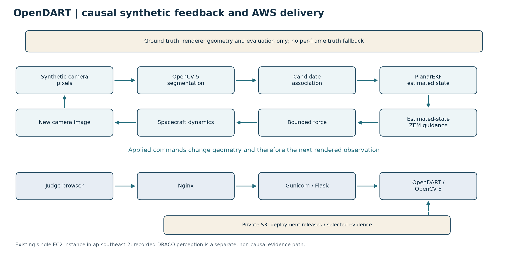
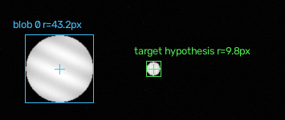
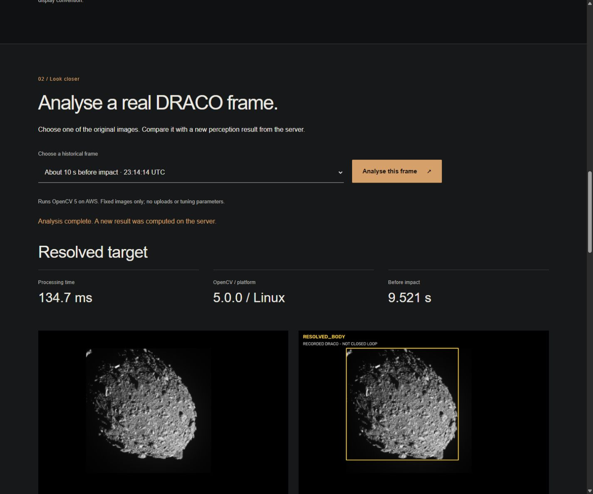

# OpenDART

Vision-driven autonomous terminal guidance with OpenCV 5

OpenDART is a research demonstrator in which camera pixels become detections, an estimated relative state and a guidance action. Applied force changes the spacecraft trajectory and the next synthetic camera image. A separate perception study processes historical DRACO flight imagery; those recorded frames cannot respond to new control commands.

Live demonstrations: [Closed-loop simulation](http://ec2-54-253-67-121.ap-southeast-2.compute.amazonaws.com/) · [Real DRACO imagery](http://ec2-54-253-67-121.ap-southeast-2.compute.amazonaws.com/draco)

Start here: [Judge Guide](JUDGE_GUIDE.pdf) · [Technical Report](OpenDART_Technical_Report_Final.pdf)

## What OpenDART does

Camera → OpenCV → state estimate → guidance → spacecraft motion → next camera image.

OpenCV 5 extracts components, weighted centroids, apparent size and contours from pixels. Association supplies a target hypothesis to a PlanarEKF; estimated-state ZEM guidance commands bounded force. Ground truth is used for rendering and evaluation, with no per-frame truth fallback into guidance. Missing imagery can trigger navigation hold and later reacquisition.

## Try it live

Select one experiment and press **Run this experiment**. Allow about 15 seconds; the service admits one computation at a time.

- **Nominal:** normal guided approach with the standard camera blackout.
- **Camera blackout:** extended loss of imagery, followed by recovery in the tested case.
- **No visual updates:** measurements disabled; an expected-miss negative control.
- **Ballistic:** guidance force disabled; an expected-miss negative control.

Completed runs show the outcome, estimation error, accepted/missing updates, navigation hold, correction delta-v and compute time. The trajectory separates the state estimate from evaluation truth. Centre distance at contact is approximately the local body radius, not residual miss distance.

## Results

- **96/96 guided tested synthetic cases reached contact**, across two appearances, 12 seeds and four conditions. Each 12/12 condition cell has Wilson 95% interval [0.758, 1.000]; paired conditions are not independent trials or a general reliability claim.
- **4/4 negative controls missed.** In the tested extended-blackout cases, a 40 s outage was followed by an accepted update at 240 s and target contact.
- The real-image autonomous method matched **6/8 compact points within 5 px**. Median point error when selected was 1.218 px (n=6). Visible regions were available in 8/8 reviewed region cases, with median IoU 0.802 (n=8).

Full-state covariance still showed substantial undercoverage, and known physical target size supplies monocular scale. Successful contact does not establish flight readiness or statistical EKF consistency.

Display detail from a nominal camera frame. Inference uses the complete frame; green marks the selected target hypothesis.

## Real DRACO imagery

The DRACO page offers 12 original calibrated PNGs, fresh server-side perception and a recorded 4,000-frame replay. Each live analysis verifies source hashes and restores validated state strictly before the chosen original image. No current-frame label or stored overlay supplies the result.

The held-out sample has 18 manually reviewed of 20 sampled frames. Two unreviewed boundary cases were excluded; there are no reviewed labels in the final ten seconds. Operator-assisted and autonomous tracking have the same median IoU, 0.871, on their identical six-region subset. A visible terrain box is not a physical centre or range measurement.

Recorded imagery supports perception replay, not closed-loop guidance validation. Original calibrated images are from the [PDS Small Bodies Node DRACO v3.0 collection](https://pds-smallbodies.astro.umd.edu/holdings/pds4-dart:data_dracocal-v3.0/).

## Architecture

The [overall system diagram](diagrams/overall_system.svg) separates rendering/evaluation truth, image-based navigation and guidance. The [Agentic Vision workflow](diagrams/agentic_vision.svg) shows how an action changes the next observation.

The existing AWS service uses Nginx, Gunicorn, Flask and OpenCV 5 on one EC2 instance. Fixed inputs, a shared computation lock, rate limits and timeouts constrain the public demonstration. See [AWS_DEMO.md](AWS_DEMO.md).

## Quick start

Use Python 3.12 and one OpenCV wheel variant. From the repository root, on Windows:

~~~powershell
python -m venv .venv
.venv/Scripts/Activate.ps1
python -m pip install -r requirements-local-py312.txt
python -m pip install --no-deps -e .
python -c "import cv2; print(cv2.__version__); assert cv2.__version__ == '5.0.0'"
python -m flask --app opendart.web:create_app run --host 127.0.0.1 --port 8000
~~~

Open http://127.0.0.1:8000/. The curated assets are included; the full DRACO source dataset is not needed for these fixed-image continuations. On Linux, use source .venv/bin/activate and the pinned [Linux requirements](deploy/aws/requirements-linux-py312.txt). The development server is for local use.

## Reproduction and limitations

[REPRODUCTION.md](REPRODUCTION.md) contains install, test, simulation, replay and report-build commands. The existing final verification records 143 passing core tests locally, from the packaged source and on Linux. The final path-only portability cleanup received static checks; these are prior execution results, not a newly rerun campaign.

The primary scene is a simplified planar model with known size and camera/attitude assumptions. The supporting 3D experiments and recorded perception study are separate evidence. Complete DRACO prefix reconstruction and independent annotation review require original inputs outside this compact repository. [MATLAB material](matlab/README.md) is secondary and unverified in the final checks.

## Documentation

- [Judge Guide](JUDGE_GUIDE.pdf): a two-page walkthrough.
- [Technical Report](OpenDART_Technical_Report_Final.pdf) and [LaTeX source](report_source/README.md).
- [Reproduction](REPRODUCTION.md), [AWS operation](AWS_DEMO.md), and [claims and limitations](CLAIMS_AND_LIMITATIONS.md).
- [Selected numerical evidence](evidence/) and [recorded DRACO replay](draco_assets/replay.mp4).
- [Portable reproduction archive](deployment/README.md), labelled separately from the unchanged deployed release.
